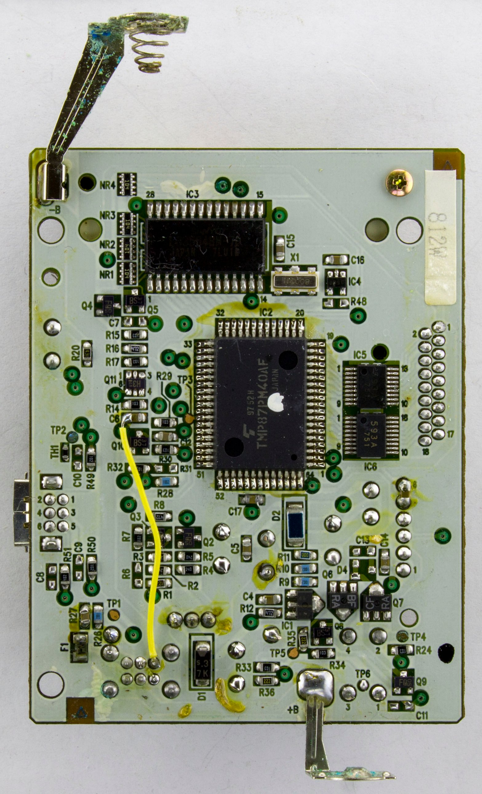
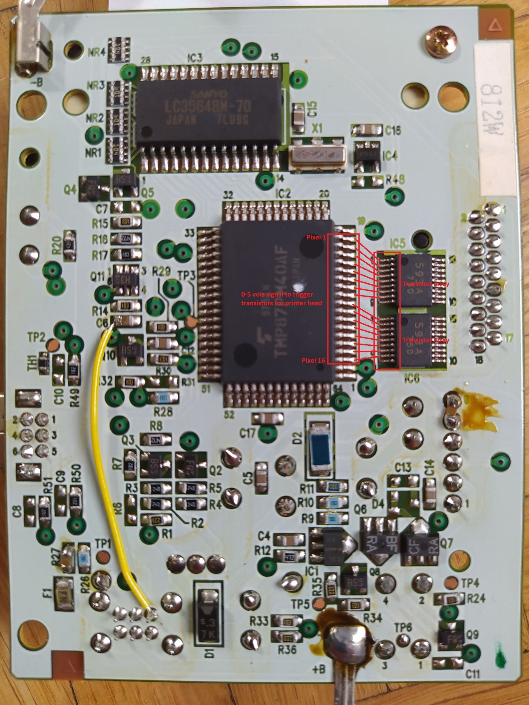

# Game-Boy-Printer-disassembly
Disassembly of the Game Boy Camera, TMP87C840 Toshiba ROM version. Work in progress

## The board (IF-GBP-02)

| [InsideGadgets's photo](https://www.insidegadgets.com/2019/03/03/inside-the-game-boy-pocket-printer/) | Head lines marked (owner's photo) |
|---|---|
|  |  |

IC2 is the TMP87PM40AF microcontroller (the one-time-programmable version of the TMP87C840) with the 8 MHz crystal X1. IC3 is the 8K x 8 image SRAM. IC5 and IC6 are TD62593A drivers for the 16 head lines (P00–P17, QFP pins 3–18). The full schematic is in [RWeick/IF-GBP-02-Gameboy-Printer](https://github.com/RWeick/IF-GBP-02-Gameboy-Printer); the pin-by-pin use is in `symbols/sfr.csv`.

## Built-in self-test banner

Holding the front button while switching on (port P2.0 read low twice at boot) makes the printer print this 160 x 16 px band, stored in the ROM at 0xDDEE-0xE06D (640 bytes, Game Boy 2bpp tiles):


## Contents

| File | What it is |
|---|---|
| [`Printer_protocol.md`](Printer_protocol.md) | The Game Boy Printer protocol as the firmware implements it: packet format, commands, status bits, image memory and compression, print parameters, timeouts, self-test, emulator checklist |
| [`TMP87C840_Toshiba_printer_ROM.bin`](TMP87C840_Toshiba_printer_ROM.bin) | The 32 KB ROM dump (md5 `aa393ec87ccb4220200255ab5adf8ac9`), mapped at 0x8000-0xFFFF |
| [`src/`](src/) | Editable source tree (modules, includes, binary tables); `make` builds `build/printer.bin`, `make check` compares it with the ROM |
| [`Makefile`](Makefile) | `make`, `make check`, `make listing`, `make source` (regenerates `src/` from `symbols/`, overwriting edits) |
| [`TMP87C840_printer_rom.asm`](TMP87C840_printer_rom.asm) | Annotated disassembly of the 32 KB ROM, generated from `symbols/` by `tools/build_listing.py` (do not edit by hand) |
| [`symbols/`](symbols/) | Names of routines, tables, RAM variables, flag bits and registers, data block types, each tagged C / I / ? |
| [`tools/t870.py`](tools/t870.py) | TLCS-870 disassembler (written from MAME's `tlcs870d.cpp` opcode map) |
| [`tools/build_listing.py`](tools/build_listing.py) | Builds the listing from the symbol files; checks names, then reassembles the listing and compares the md5 |
| [`tools/t870asm.py`](tools/t870asm.py) | TLCS-870 assembler (source tree and listing): `python3 tools/t870asm.py src/main.asm out.bin` |
| [`tools/make_source.py`](tools/make_source.py) | Writes `src/` from the annotated listing |
| [`tools/trace.py`](tools/trace.py) | The first plain tracer (unnamed listing), kept for reference |
| [`tools/check_repo_consistency.py`](tools/check_repo_consistency.py) | Consistency check: quoted numbers, fresh generated files, links, builds (`--slow` re-runs the emulator checks) |
| [`emulator/`](emulator/) | Emulator that runs this ROM on an emulated TMP87C840 and talks to it like a Game Boy; `claims.py` checks the protocol reference against the firmware (23 checks, all matching) |
| [`printer_test_image.png`](printer_test_image.png) | The built-in self-test image (ROM 0xDDEE-0xE06D, 160 x 16 px), drawn 4x |

All of this is AI work, from reading the code and running it in the emulator, waiting for validation on real hardware.

## Building

```
make          # build/printer.bin from src/
make check    # md5 must be aa393ec87ccb4220200255ab5adf8ac9
```

Only Python 3 is needed (`make` is optional: `python3 tools/t870asm.py src/main.asm build/printer.bin` then `python3 tools/check_md5.py build/printer.bin aa393ec87ccb4220200255ab5adf8ac9`).

## Disassembly status

| Level | State |
|---|---|
| L0 listing reassembles to the same md5 | done: `tools/t870asm.py` assembles the instruction and data text of the listing (ignoring the hex column, computing every address itself) to md5 `aa393ec87ccb4220200255ab5adf8ac9`; the build checks it every time |
| L1 every byte typed | done: code 16,220 B, jump tables 2,238 B, tables 6,263 B (3,883 B byte tables + 2,380 B word tables), fill 8,047 B |
| L2 code traced and run | done: all indirect jumps resolved; 88 % of the code bytes run in the emulator, nothing runs outside the trace |
| L3 names | 160 ROM names, 76 RAM variables, 61 flag bits, 37 registers: 286 tagged C, 11 I, 0 ?; 898 short branch targets keep automatic labels |
| L4 RAM and registers in the source | done: every RAM variable, flag bit and register the code uses is named in the listing |
| L5 buildable tree | done: `src/` (10 modules, 2 include files, 14 binary tables) builds with `make`, and `make check` gives the ROM md5. All ROM addresses are symbolic; code inserted in three modules still gives a working firmware in the emulator (`emulator/relocation_test.py`) |
| L6 understanding | protocol verified in the emulator; strobe timing matches a real printer; the head energy model (per-dot history, per-element heat, tick curves) and every table decoded; 11 inferred names left (`symbols/README.md`) |

## Sources

- The printer ROM dump and the Toshiba TMP87C840 datasheet (`TMP87C840_Toshiba.pdf`), from the owner's source pack in [Game-Boy-Camera-disassembly](https://github.com/Raphael-Boichot/Game-Boy-Camera-disassembly) (`Source_material/Source_material.zip`): pinout, register maps, timers, serial interface, A/D converter.
- [MAME TLCS-870 core](https://github.com/mamedev/mame/tree/master/src/devices/cpu/tlcs870) (`tlcs870d.cpp`, `tlcs870*.cpp`, BSD-3-Clause): opcode map for `tools/t870.py`, and Toshiba's instruction and flag table quoted in its comments, used for the emulator CPU. No MAME code is included.
- [RWeick/IF-GBP-02-Gameboy-Printer](https://github.com/RWeick/IF-GBP-02-Gameboy-Printer): complete schematic, KiCad PCB and Gerbers of the printer board (IF-GBP-02); every MCU pin's net (head drivers, motor connector, sensors, thermistor, battery divider, power hold, link port).
- The owner's photos of the printer board (`hardware/`) and scope measurements of the head strobes (4 ms per pixel column; 1.56 / 1.20 / 0.96 ms at exposure 64) made by [Furrtek](https://furrtek.org/?a=gbprinter&i=2).
- [Game-Boy-Camera-disassembly](https://github.com/Raphael-Boichot/Game-Boy-Camera-disassembly): the disassembly playbook (levels L0–L6) and the C / I / ? evidence tags followed here.
- Printer ROM provided by [Cristofer Cruz](https://github.com/cristofercruz), big thanks to him.
